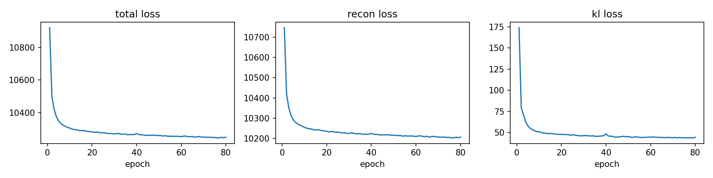
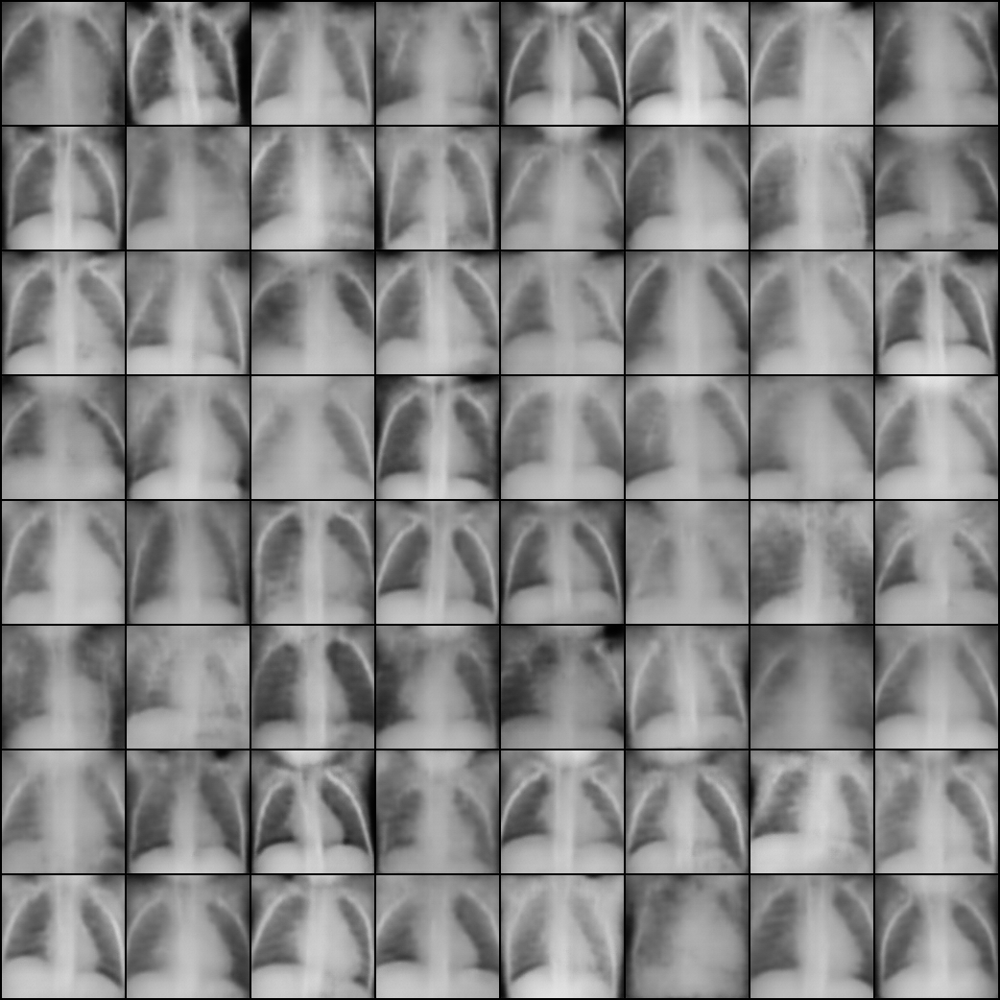

# Chest X-ray Generation with a Convolutional VAE

A PyTorch variational autoencoder for unconditional generation of **128 x 128 grayscale chest X-rays**. NORMAL and PNEUMONIA images are pooled without conditioning on labels.

## Files

```text
README.md
requirements.txt
as1.ipynb
outputs/
  config.json
  loss_history.json
  loss_curves.png
  final_samples.png
  samples_epoch10.png
  samples_epoch20.png
  samples_epoch30.png
  samples_epoch40.png
  samples_epoch50.png
  samples_epoch60.png
  samples_epoch70.png
  samples_epoch80.png
  metrics_128.json
  provenance.json
```

`as1.ipynb` at the repository root is the project notebook. Run it from the repository root so its relative data and output paths resolve correctly. Saved experiment artifacts are in `outputs/`. Old decoder experiments and report files are not included in the upload scope.

## Dataset

Download [Chest X-Ray Images (Pneumonia)](https://www.kaggle.com/datasets/paultimothymooney/chest-xray-pneumonia) separately, following its applicable usage terms. Place it at the repository root:

```text
chest_xray/
  train/NORMAL/
  train/PNEUMONIA/
  val/NORMAL/
  val/PNEUMONIA/
  test/NORMAL/
  test/PNEUMONIA/
```

Local split sizes: train 5,216; validation 16; test 624. This original notebook trains on the training split and evaluates generation on the test split. It does not use validation-based checkpoint selection.

## Installation and running

Use a virtual environment, then:

```bash
python -m pip install -r requirements.txt
```

Open `as1.ipynb` in VS Code or Jupyter and select that environment. Python 3.13.2 is recorded in the source notebook. For a browser interface, optionally install JupyterLab with `python -m pip install jupyterlab` and launch `python -m jupyterlab`.

**Use the repository root as the kernel working directory**, because dataset and output paths are relative to it.

Run the cells in order to train and evaluate. Running all cells starts a fresh training run using the current `EPOCHS` value in the notebook and writes to `outputs/`; back up any existing outputs first. **No training or evaluation was rerun to prepare these repository files.**

For CUDA, use a matching PyTorch/torchvision CUDA build from the [official installation selector](https://pytorch.org/get-started/locally/). The dependency pins record local package versions but do not specify a CUDA build. Inception weights require network access on first metric evaluation. If DataLoader workers hang on Windows/Jupyter, try `num_workers=0` instead of the original setting of 2.

## Model and hyperparameters

Five encoder blocks use stride-2 convolutions with channels 32, 64, 128, 256, 512, BatchNorm and LeakyReLU. Linear heads predict a diagonal Gaussian mean and log-variance. Reparameterization produces latent samples. The decoder uses transposed convolutions with BatchNorm/ReLU and a final Sigmoid.

| Setting | Value |
|---|---|
| Image size | 128 x 128, grayscale |
| Preprocessing | Resize preserving aspect ratio, CenterCrop, ToTensor [0,1] |
| Latent dimension | 128 |
| Optimizer | Adam |
| Learning rate | 0.001 |
| Batch size | 64 |
| Epochs | 80 |
| KL weight | 1.0 |
| Training / evaluation seed | 42 / 342 |

The objective is pixel-summed BCE plus KL divergence, averaged over images. The original loader uses `drop_last=True`, so 32 shuffled training images are omitted each epoch. Final-epoch weights are saved to `outputs/vae.pt` and are not included in the upload package.

## Existing results

| Metric | Value |
|---|---:|
| Final training total loss | 10250.8882 |
| Final reconstruction loss | 10206.5100 |
| Final KL | 44.3783 |
| Ignite-default FID (lower is better) | 0.152624 |
| Inception Score | 1.670664 |
| Real / generated evaluation count | 624 / 624 |

Losses are in nats per image. Values are taken from the current saved JSON files, not earlier screenshots.





Fixed-latent samples every 10 epochs through epoch 80 are also included. `outputs/config.json` records the configuration packaged with the saved 80-epoch results; it is not automatically synchronized when the notebook is edited. `outputs/provenance.json` records file paths and checksums, including the current root notebook. Saved results describe the completed experiment, not a guarantee that the current notebook is unchanged from that run.

## Training interpretation

The saved history contains **80 epochs**. Total loss decreases from 10920.2916 to 10250.8882. Between epochs 30 and 80, it falls from 10270.5571 to 10250.8882, an improvement of only 0.192%, indicating diminishing returns. Some samples show more local texture, but remain blurred; anatomical fidelity has not been established. No validation-loss curve is recorded, so this run does not establish overfitting.

## Evaluation and limitations

Evaluation follows the [assignment's Ignite tutorial](https://pytorch-ignite.ai/blog/gan-evaluation-with-fid-and-is/). The model generates 624 independent samples from the standard-normal latent prior. Real test images use the original Resize + CenterCrop preprocessing. Both streams are converted to RGB and resized with PIL bilinear interpolation to 299 x 299. FID uses both streams; Inception Score uses only generated images.

These scores use **Ignite's default 1000-dimensional ImageNet Inception output**, rather than pool3-2048 FID. Do not compare them directly against other FID implementations. The sample size is limited, and ImageNet features do not establish anatomical or diagnostic accuracy. Generated images capture coarse structure but remain blurred. Fixed seeds do not guarantee identical results across hardware and software environments.

## GitHub upload

Commit `README.md`, `requirements.txt`, `.gitignore`, the root `as1.ipynb`, and the images/JSON files in `outputs/`. Do not include the dataset, weights, virtual environments or older experiments. Review the course policy before publishing assignment solutions. No license is assumed or assigned by this packaging step.
